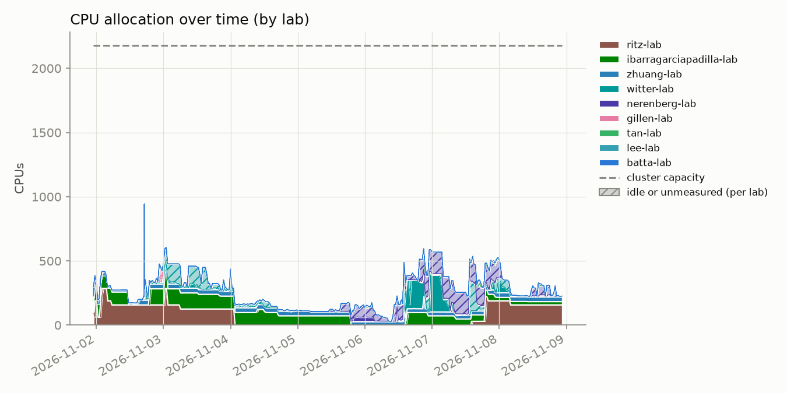
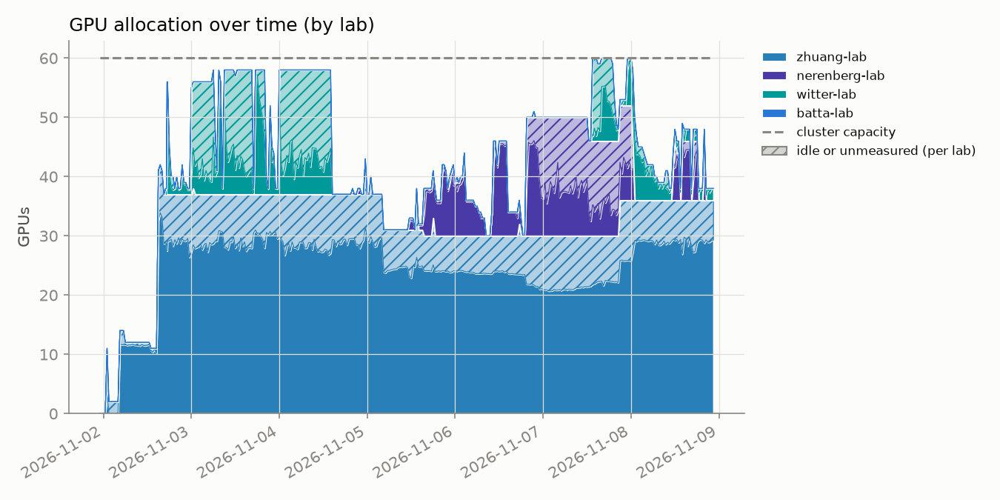
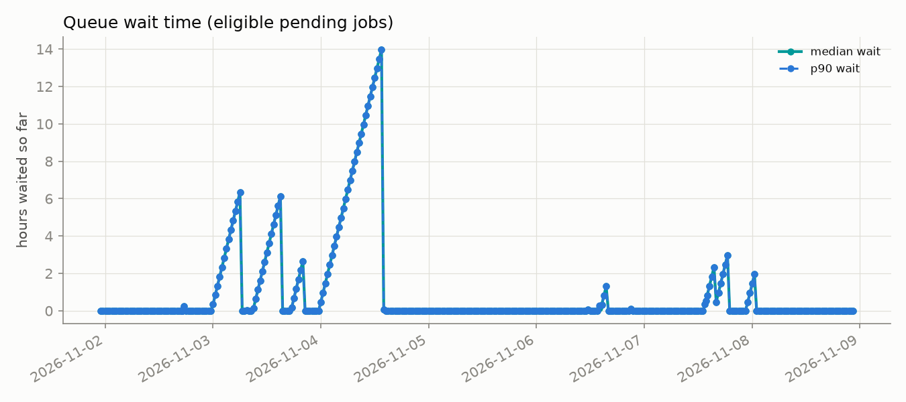
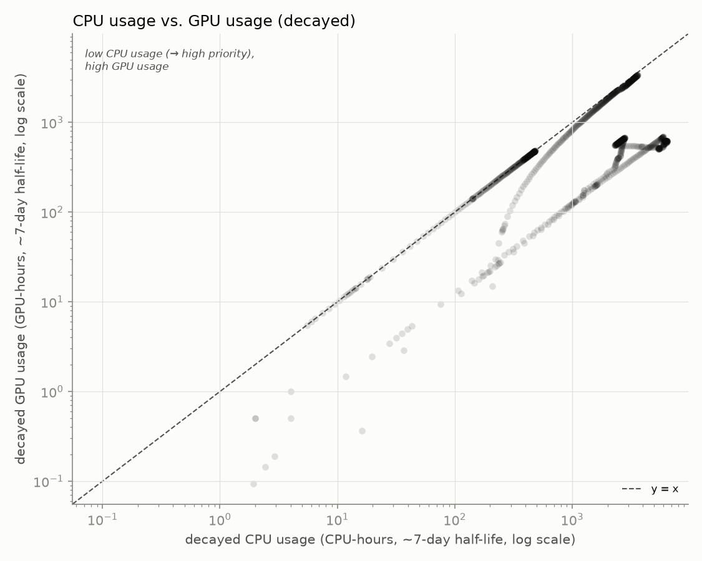

# hopper_monitor

Archived weekly snapshot: **2026-11-02 to 2026-11-08**. Usernames are anonymized to a stable per-account pseudonym; lab names are real.

[Back to the live dashboard](../../README.md)

Samples: 341 queue snapshots, 341 GPU snapshots

## Headline

- **70.1%** of the cluster's 60 GPUs allocated, averaged across all samples
- **66.2%** average observed `nvidia-smi` utilization *when* a GPU is allocated to a job
- **81.3%** average cgroup CPU utilization *when* a CPU is allocated to a job

## Per lab / per user

<table>
<tr><th>Lab</th><th>User</th><th align='right'>GPU-hours allocated</th><th align='right'>GPU utilization</th></tr>
<tr style='background-color:#deebf4'><td>zhuang-lab</td><td>user-0db9ced0</td><td align='right'>4559.9</td><td align='right'>74%</td></tr>
<tr style='background-color:#d8efef'><td>witter-lab</td><td>user-554c620c</td><td align='right'>927.8</td><td align='right'>38%</td></tr>
<tr style='background-color:#e3e1f1'><td>nerenberg-lab</td><td>user-7eb22d7c</td><td align='right'>815.5</td><td align='right'>52%</td></tr>
<tr style='background-color:#deebf4'><td>zhuang-lab</td><td>user-e67a8f7c</td><td align='right'>728.0</td><td align='right'>72%</td></tr>
<tr style='background-color:#deebf4'><td>zhuang-lab</td><td>user-7d156b54</td><td align='right'>25.0</td><td align='right'>17%</td></tr>
<tr style='background-color:#e3e1f1'><td>nerenberg-lab</td><td>user-fedb5feb</td><td align='right'>1.0</td><td align='right'>74%</td></tr>
<tr style='background-color:#dfeaf8'><td>batta-lab</td><td>user-1b9ffded</td><td align='right'>0.5</td><td align='right'>100%</td></tr>
<tr style='background-color:#fbebf1'><td>gillen-lab</td><td>user-b89a87ef</td><td align='right'>0.0</td><td align='right'>—</td></tr>
<tr style='background-color:#d8ecd8'><td>ibarragarciapadilla-lab</td><td>user-40b4d372</td><td align='right'>0.0</td><td align='right'>—</td></tr>
<tr style='background-color:#e0f0f3'><td>lee-lab</td><td>user-cc2dcb8d</td><td align='right'>0.0</td><td align='right'>—</td></tr>
<tr style='background-color:#e3e1f1'><td>nerenberg-lab</td><td>user-b12dc074</td><td align='right'>0.0</td><td align='right'>—</td></tr>
<tr style='background-color:#e3e1f1'><td>nerenberg-lab</td><td>user-d0d00610</td><td align='right'>0.0</td><td align='right'>—</td></tr>
<tr style='background-color:#ede5e4'><td>ritz-lab</td><td>user-2d24ef25</td><td align='right'>0.0</td><td align='right'>—</td></tr>
<tr style='background-color:#ede5e4'><td>ritz-lab</td><td>user-938729e2</td><td align='right'>0.0</td><td align='right'>—</td></tr>
<tr style='background-color:#e0f3e7'><td>tan-lab</td><td>user-74ff0ebc</td><td align='right'>0.0</td><td align='right'>—</td></tr>
<tr style='background-color:#e0f3e7'><td>tan-lab</td><td>user-757a321c</td><td align='right'>0.0</td><td align='right'>—</td></tr>
</table>

## Usage over time

Charts below cover this week: **2026-11-02 00:00 to 2026-11-09 00:00** (UTC-07:00).

Each named lab has its own color. Solid = utilized by lab, hatched = allocated but idle or unmeasured, gray = usage not traceable to a lab, dashed line = cluster capacity. Zero-usage legend entries are omitted.

Attribution combines `nvidia-smi`'s process listing with Slurm's GPU-to-job binding record; the latter caught **1732** readings the former missed.
Allocation counts include all nodes of each job, including corrected historical totals. Before October 2, 2026, utilization sampling could skip nodes in compressed hostlists; those missing readings cannot be reconstructed and do not establish that the GPUs were idle.
GPU-hour estimates credit at most one 30-minute interval per sample; collector outages are not extrapolated. CPU utilization is weighted by the allocated cores of jobs with observed counters.

## Queue

"Pending" here means Slurm is actively scoring the job (has a `sprio` priority) - excludes jobs blocked on a dependency or array-task throttle.

## CPU usage vs. GPU usage

One point per user per snapshot (n=989), usage decayed on Slurm's ~7-day fairshare half-life.

GPU usage is weighted into fairshare priority on this cluster (`TRESBillingWeights`/`PriorityWeightTRES` set).

